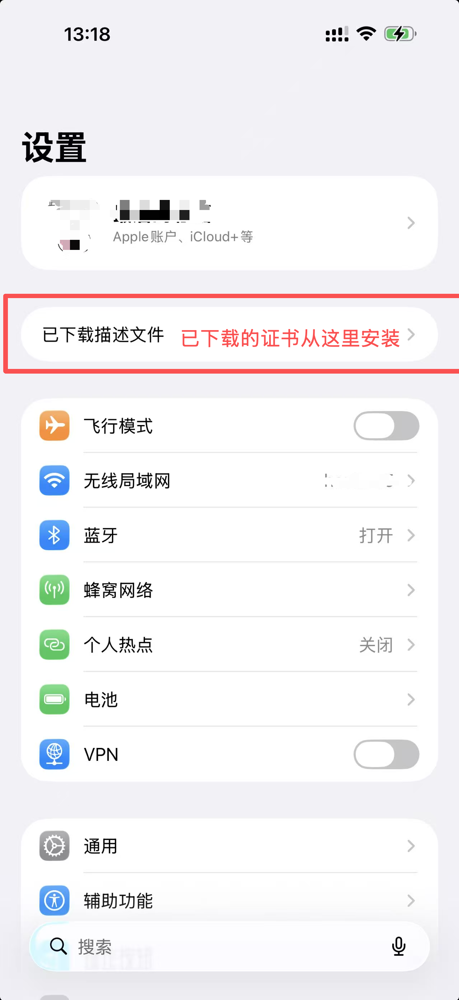
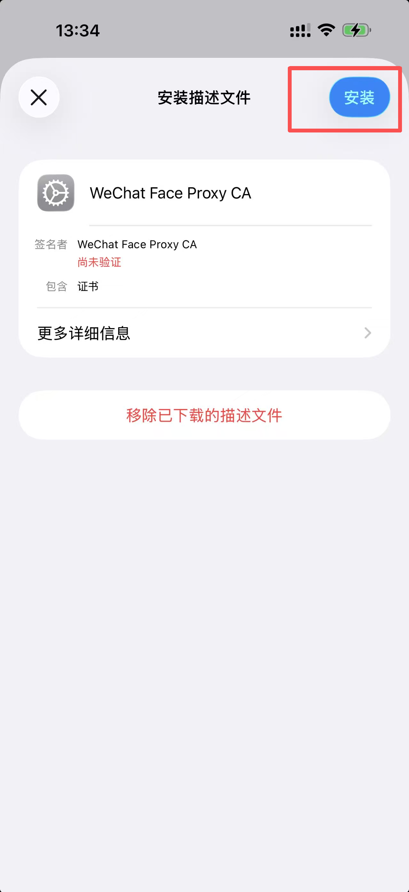
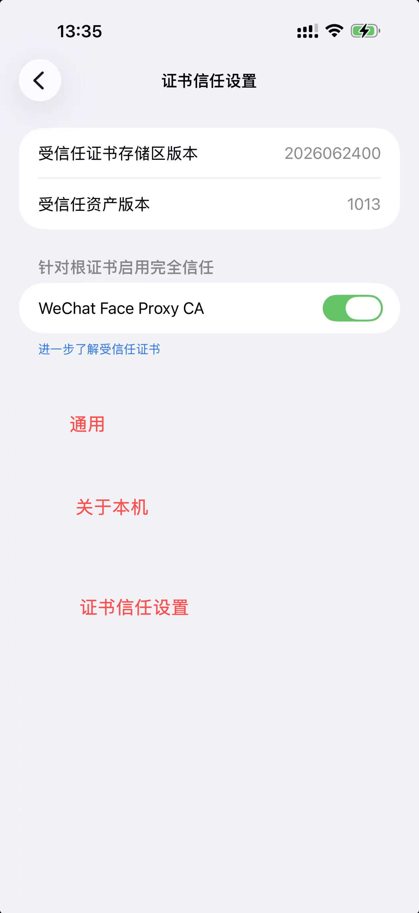
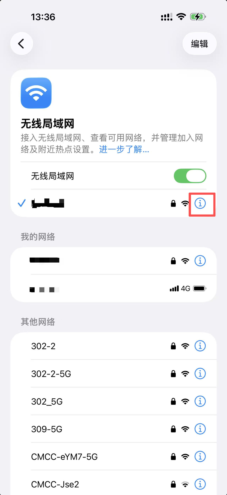
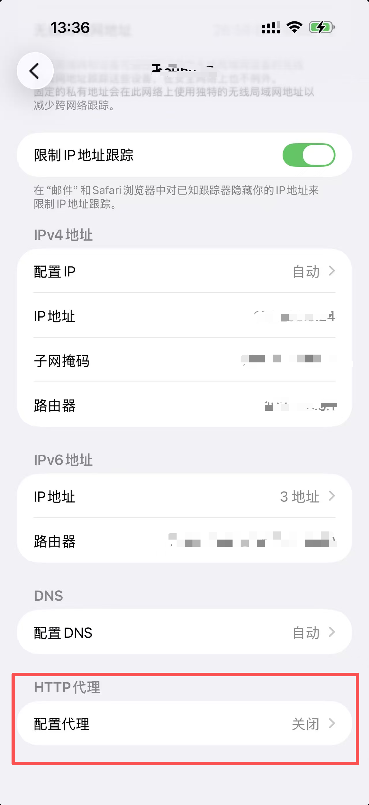
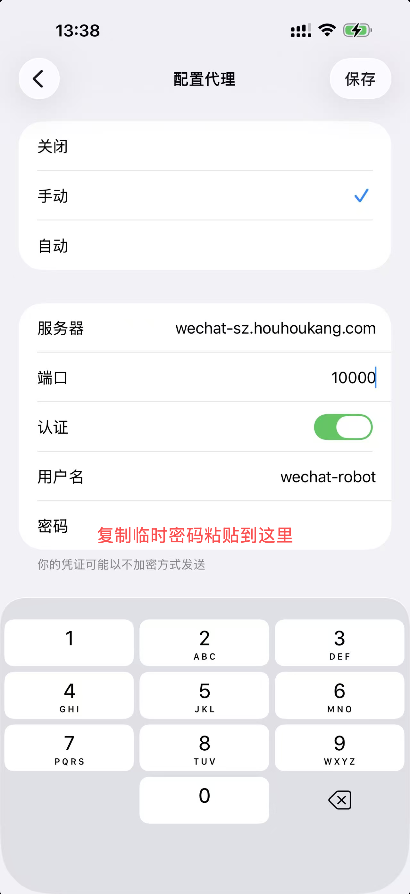
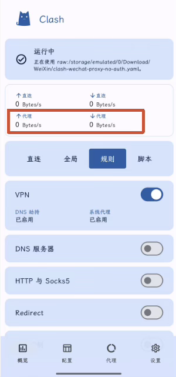
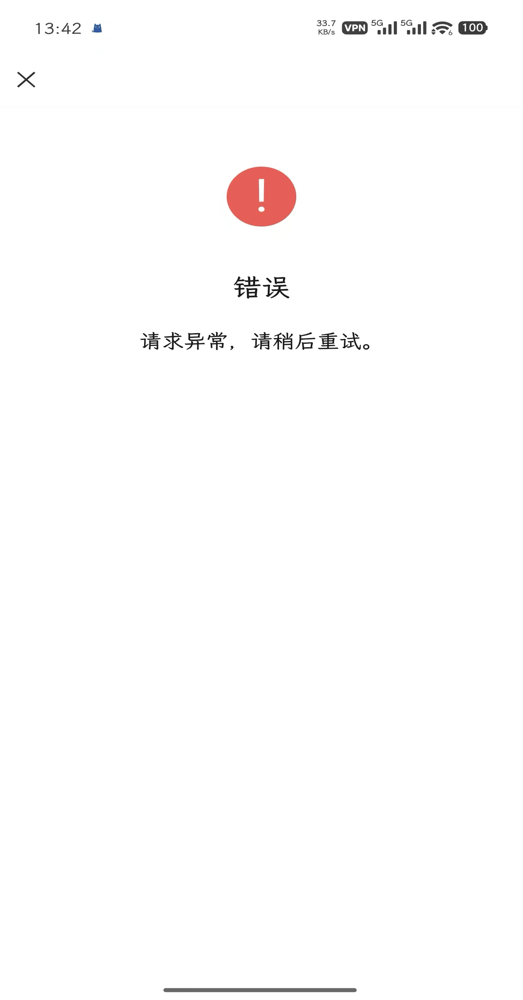

# 快速开始

## 部署前的准备

::: warning 注意
仅支持部署在 Windows 系统和 Linux 系统，本章节不讲解 Mac 部署，Mac 部署请自行研究。
:::

- 系统已经安装 Git，用于克隆项目

- 系统已经安装`Docker Desktop`，即 Docker 和 docker-compose 组件

- 系统已安装`OpenSSL` (Windows 系统可以选择安装`Git`，附带`OpenSSL`)，用于 https 证书签名

- 网络能拉取 Docker 镜像

## 快速部署

Windows 请在 **PowerShell** 中执行，Linux 请在终端中执行。下面的步骤请在同一个终端中依次完成。

### 1. 克隆项目并创建网络

```bash
# 克隆本项目
git clone https://github.com/hp0912/wechat-robot-client.git

# 进入部署目录，后续命令都在此目录下执行
cd ./wechat-robot-client/.deploy/local

# 如果以前没有创建过此 Docker 网络，先创建网络
docker network create wechat-robot
```

### 2. 生成并检查 HTTPS 证书

根据系统选择下面一种方式执行，将示例中的 `192.168.1.10` 替换为部署电脑的局域网 IP。

**Windows（PowerShell）**

```powershell
# 生成证书
powershell -NoProfile -ExecutionPolicy Bypass -File .\gen-self-signed-cert.ps1 -IpAddresses 192.168.1.10

# 检查证书和私钥是否存在，以及文件大小
Get-Item .\secrets\nginx\tls.crt, .\secrets\nginx\tls.key -ErrorAction Stop |
  Select-Object Name, Length
```

**Linux**

```bash
# 生成证书
sh ./gen-self-signed-cert.sh --ip 192.168.1.10

# 检查证书和私钥是否存在，以及文件大小
ls -l ./secrets/nginx/tls.crt ./secrets/nginx/tls.key
```

检查结果必须同时包含 `tls.crt` 和 `tls.key` 两个文件，且文件大小都不为 `0`。

### 3. 启动容器

下面两个命令选择一个执行：

```bash
docker compose up -d

# 如果上面的命令不可用，使用这个命令
docker-compose up -d
```

::: info 温馨提示
如果拉镜像失败，请确认 docker 是否设置代理，并尝试逐个手动拉取镜像，个别镜像体积较大，批量拉容易失败
:::

## 访问管理后台

浏览器访问`https://127.0.0.1:8443`，登录密钥`12345678`

## 创建机器人

- 点击右上角`创建机器人`按钮，新建一个机器人实例，创建时间可能会比较长，请耐心等待

- 创建完成后，机器人列表会出现机器人卡片，点击卡片右上角的扫码登录按钮，选择扫码登录方式

- 推荐使用 iPad 登录，登录不上再使用 Mac 登录，不要使用车载微信登录，拉 docker 镜像、克隆代码的时候如果开了梯子，扫码的时候记得把梯子关了，你会设置腾讯域名白名单，可以开着梯子，否则扫码登录后都不能开梯子。

- 扫码的时候，把同步最近消息取消勾选，因为机器人默认开启 AI 聊天，如果勾选同步历史消息，历史消息会触发 AI 聊天，导致刷屏。

- 登录成功后，即可点击下面一排按钮中的第一个，进入机器人详情界面，进行自定义配置

- 风控建议
  - 注册两年以上的小号，登录后挂机四小时
  - 注册半年以上的小号，挂机三天
  - 刚注册的小号，挂机一个月

## 特别注意

::: danger 登录方式
目前只有`iPad`和`Mac`登录方式是稳定的，其他登录方式要么不可用要么容易封号。`Mac`登录方式如果需要过滑块，进交流群发送`#过滑块密钥`获取最新密钥，解决 401 的问题(密钥过期了)。
:::

::: danger 弱口令警告
默认配置包含很多弱口令，所以不要放在公网访问
:::

## 后端接口文档

https://wechat-sz.houhoukang.com/api/v1/swagger/doc.json

## 扫码后手机上没有登录按钮怎么办？

**前置条件**：你有两个手机，一个用来登录微信机器人，另一个用来过人脸认证。

这是触发了微信的人脸安全认证，这个时候微信管理后台的扫码弹窗会自动跳转到人脸认证界面，有一个人脸认证二维码，下方还有一个 `手机代理设置`。

手机扫码人脸认证的二维码后，会引导你先下载并信任证书、设置手机代理，代理用到的临时密码有 30 分钟有效期，有效期内可以重复使用，不用每次都设置代理账号密码。

安装并信任证书可以提前操作，iPhone 手机使用 Safari 浏览器打开 https://wechat-sz.houhoukang.com/api/v1/robot/login/pad-face-ca 下载证书并安装。

::: danger 代理地址
需要特别注意的是，`代理地址` 不能是 127.0.0.1 或者 localhost，如果显示的是 127.0.0.1 或者 localhost，请替换成部署机器人的电脑的局域网 IP ，且确保该电脑 10000 端口已经放开且手机能访问这个局域网 IP。
:::

1. 扫描人脸二维码必须用另外一个手机微信，登录机器人的那个手机微信里面的登录弹窗不能关闭，否则会导致人脸认证启动失败。特别注意，如果你没有两个手机，无法实现人脸认证，安卓的微信多开方案行不通。

2. 用另外一个手机上的已登录微信(登录任意账号即可)，扫描人脸认证二维码，然后会在微信内打开一个网页，必须先按照网页上的 `手机代理设置` 的教程设置好手机代理，然后再点击最下方的 `开始人脸验证` 按钮进入人脸认证流程。
   - `手机代理设置` 下方有一个 `下载代理 CA 证书` 的按钮，点击下载并安装证书，如果安装失败，请点击 `复制证书下载地址` 按钮复制链接到手机浏览器打开，苹果手机请使用 Safari 浏览器打开
   - 安装完证书之后，必须设置信任证书，然后配置代理，下面是苹果手机的安装证书、信任证书、设置代理的详细步骤，安卓手机需要使用 VPN，步骤略。
   - 证书和代理设置好了之后，就可以扫描人脸认证二维码了，按提示操作即可，通过了人脸认证之后会有一个下一步，点击没反应，不管它，切换到登录机器人的那个微信，这个时候登录弹窗应该出现了确认按钮，点击确定，管理后台会自动进行后续步骤，直到登录成功。

### 苹果手机

<table>
  <tbody>
    <tr>
      <td>
        
      </td>
      <td>
        
      </td>
      <td>
        
      </td>
      <td>
        
      </td>
      <td>
        
      </td>
      <td>
        
      </td>
    </tr>
  </tbody>
</table>

### 安卓手机

以下操作都是在人脸认证的那个手机操作，登录机器人微信的手机无需操作。

> 用于人脸认证的手机，安装 CA 证书步骤(没有苹果手机信任证书那一步)

以小米手机为例：

设置 → 搜索“CA” → 安装 CA 证书 → 选择下载好的证书文件

不同品牌安卓手机入口可能略有区别，可以直接在系统设置中搜索：

CA 证书 / 安装证书 / 凭据

完成安装后再进行下一步。

> 由于安卓手机的原生代理设置不支持账号密码认证，所以需要借助第三方 VPN 工具

下载安装 Clash，然后新建一个 .yaml 配置文件。

安装配置步骤：clash→配置→新配置→本地→选择 .yaml配置文件 →提交→选择配置

如果不会写 YAML，可以把代理地址、端口、账号和密码发给 AI，让 AI 生成 Clash 配置。

示例配置：

```yaml
mixed-port: 7890
allow-lan: false
mode: rule
log-level: info

proxies:
  - name: "wechat-proxy"
    type: http
    server: "你的代理地址"
    port: 10000
    username: "wechat-robot"
    password: "你的代理密码"

proxy-groups:
  - name: "PROXY"
    type: select
    proxies:
      - "wechat-proxy"
      - DIRECT

rules:
  - MATCH,PROXY
```

启动代理 → 选择 Rule / 规则模式 → 确认 wechat-proxy 已连接。

上面的 server 和 password 替换成实际的。

以下情况为代理未正确配置：

1. 代理上下为0



2. 微信无网络，微信扫码后错误



**最后：安卓手机代理配置略显复杂，建议借你朋友的苹果手机过人脸。**
